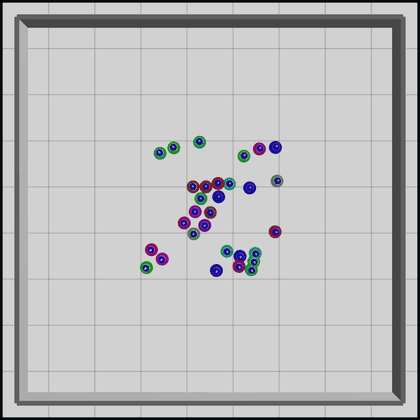
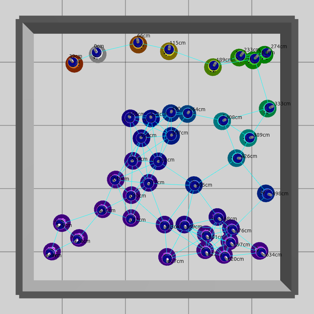
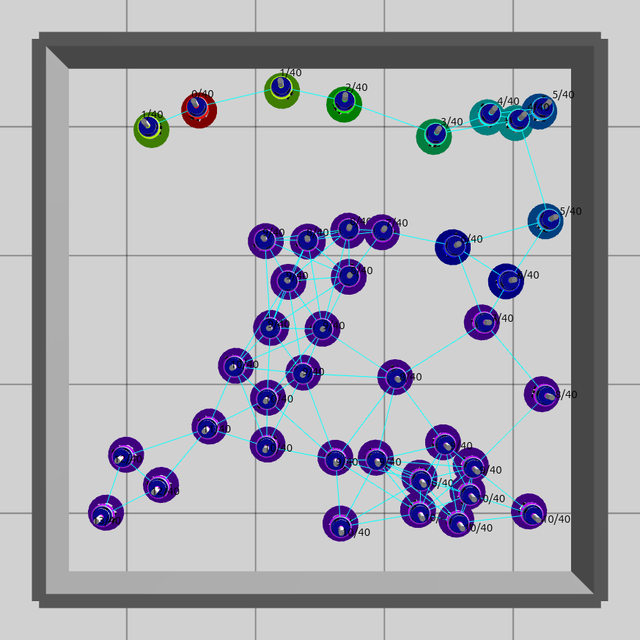
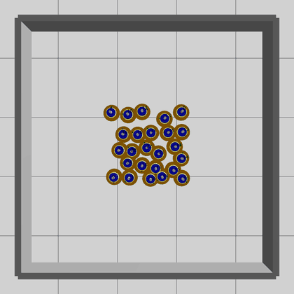
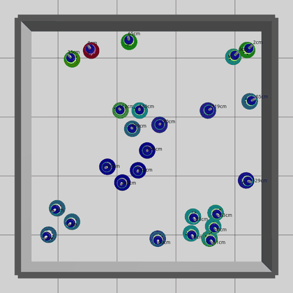
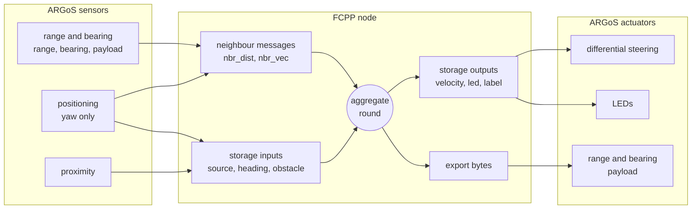

# FCPP + ARGoS: aggregate programming for robot swarms

<p align="center"></p>

This repository shows how to run **aggregate programs** written with [FCPP](https://github.com/fcpp/fcpp) on
**simulated robot swarms** in [ARGoS3](https://github.com/ilpincy/argos3).

In aggregate programming you write one program for the whole swarm. Every robot runs it in rounds. In each round it
reads its sensors and the messages from its neighbours, computes, and broadcasts its state. Neighbour interaction is
expressed with *fields*: a field holds one value per neighbour. Collective behaviours are then composed out of
reusable building blocks: gradients, broadcasts, collections, leader election.

Here every ARGoS foot-bot runs an FCPP node. Neighbours exchange FCPP messages over the simulated
range-and-bearing radio, and the program drives the wheels and LEDs. There are five examples: two **static**, two
**moving** and one **advanced**.

- [Examples](#examples)
- [Quick start](#quick-start)
- [How the integration works](#how-the-integration-works)
- [Writing your own example](#writing-your-own-example)
- [Pitfalls](#pitfalls)

## Examples

In the pictures, the **coloured halo** around each robot is its LED colour and the **text** is its label. Both are
set by the aggregate program. Cyan lines (static examples only) are the radio links.

### Static: distance gradient (`gradient`)



Every robot estimates its distance from the source `fb0` (white), measured **along the network**, hop by hop. The
range-and-bearing range is FCPP's `nbr_dist()`, so the library gradient `abf_distance` works as is.

```cpp
MAIN() {
    bool source = node.storage(tags::source{});   // <params source="0"/>
    real_t d = abf_distance(CALL, source);
    node.storage(tags::led{}) = source ? color(WHITE) : color::hsva(std::min<real_t>(d, 6) * 45, 1, 1);
    node.storage(tags::label{}) = d < INF ? std::to_string(int(d * 100)) + "cm" : "?";
}
```

**What to look at:** colours go from red to violet as the distance grows. Distances are path lengths: robots in
the bottom half read 5–7 m because their only route to the source goes round the right side.

<br clear="right">

### Static: leader election and counting (`election`)



No robot is special this time. The swarm composes four building blocks:

1. elects a leader, the lowest uid (`wave_election`);
2. computes hop counts from it (`abf_hops`);
3. **collects** the number of robots towards it, along the hop gradient (`sp_collection`);
4. **broadcasts** the total back to everybody (`broadcast`).

```cpp
MAIN() {
    bool leader = wave_election(CALL) == node.uid;
    hops_t hops = abf_hops(CALL, leader);
    int count = sp_collection(CALL, hops, 1, 0, [](int x, int y) { return x + y; });
    int total = broadcast(CALL, hops, count);
    node.storage(tags::label{}) = std::to_string(hops) + "/" + std::to_string(total);
    // ... LED colour
}
```

**What to look at:** labels are `hops/swarm size`. After a few seconds every robot knows that the swarm has 40
robots, and the red robot is the leader.

<br clear="right">

### Moving: dispersion (`dispersion`)



Robots start packed together and push each other away until nobody is closer than 0.6 m. The push comes from
FCPP's library spring `neighbour_elastic_force`, which works on `nbr_vec()`. Its strength is a *field*: 1 for
neighbours closer than 0.6 m, 0 for the others. So the spring only pushes. A spring that also pulls makes a dense
swarm collapse instead.

```cpp
MAIN() {
    vec<2> force = neighbour_elastic_force(CALL, 0.6, mux(node.nbr_dist() < 0.6, 1.0, 0.0));
    node.storage(tags::velocity{}) = force + 0.05 * node.storage(tags::obstacle{});
    node.storage(tags::led{}) = norm(force) < 0.02 ? color(GREEN) : color(ORANGE); // green = settled
}
```

**What to look at:** orange robots are still moving. Within about 10 s the swarm turns green and forms a regular
lattice.

<br clear="right">

### Moving: gathering around a leader (`gathering`)



The swarm elects a leader (red) and gathers around it. Robots cannot see the leader, and there is no GPS. Each
robot computes its **vector to the leader** as "vector to my parent + my parent's vector to the leader". The parent
is the neighbour closest to the leader on the distance gradient, and the vector to it comes from `nbr_vec()`. The
result is path integration, done collectively.

```cpp
device_t parent = get<1>(min_hood(CALL, make_tuple(nbr(CALL, dist), nbr_uid(CALL))));
vec<2> to_leader = nbr(CALL, vec<2>{}, [&](field<vec<2>> x) {
    vec<2> via_parent = sum_hood(CALL, mux(nbr_uid(CALL) == parent, x + node.nbr_vec(), vec<2>{}), vec<2>{});
    return leader ? vec<2>{} : via_parent;
});
node.storage(tags::velocity{}) = leader ? vec<2>{} : 0.3 * to_leader + 2 * separation + ...;
```

**What to look at:** robots head straight for the leader, even when it is several hops away, and stop in a compact
cluster. Labels show each robot's estimated distance to the leader.

<br clear="right">

### Advanced: flocking (`flocking`)


The three [Reynolds rules](https://www.red3d.com/cwr/boids/), each one a field operation:

- **separation**: push away from neighbours closer than 0.6 m (`nbr_vec`);
- **cohesion**: move towards the centre of the neighbourhood (mean of `nbr_vec`);
- **alignment**: head where the neighbours head (mean of `nbr(heading)`; headings come from the compass, so they
  share one frame).

```cpp
MAIN() {
    vec<2> heading = node.storage(tags::heading{});
    vec<2> separation = sum_hood(CALL, map_hood([](vec<2> v) {
        real_t d = norm(v);
        return d > 0 and d < 0.6 ? -v / (d * d) : vec<2>{};
    }, node.nbr_vec()), vec<2>{});
    vec<2> cohesion = mean_hood(CALL, node.nbr_vec(), vec<2>{});
    vec<2> alignment = mean_hood(CALL, nbr(CALL, heading));
    vec<2> steer = alignment + cohesion + 0.5 * separation + 0.5 * node.storage(tags::obstacle{});
    node.storage(tags::velocity{}) = norm(steer) > 0 ? steer / norm(steer) * 0.08 : vec<2>{};
    node.storage(tags::led{}) = color::hsva(std::atan2(heading[1], heading[0]) * 180 / M_PI + 180, 1, 1);
}
```

**What to look at:** the LED hue is the heading, so **one colour means aligned**. The swarm starts multicoloured,
agrees on a direction within seconds, and then moves as a single evenly spaced flock. It turns together (and
changes colour) when it reaches a wall.

<br clear="right">

## Quick start

Tested on Ubuntu 26.04 (g++ 15, CMake 4.2, Qt 6). There is no ARGoS package for recent Ubuntu, so it is built from
source:

```bash
# 1. ARGoS dependencies
sudo apt install build-essential git cmake libfreeimage-dev libfreeimageplus-dev qt6-base-dev libglut-dev libxi-dev libxmu-dev

# 2. ARGoS
git clone https://github.com/ilpincy/argos3.git
cmake -S argos3/src -B argos3/build_simulator -DCMAKE_BUILD_TYPE=Release -DARGOS_DOCUMENTATION=OFF
cmake --build argos3/build_simulator -j"$(nproc)"
sudo cmake --install argos3/build_simulator && sudo ldconfig
argos3 -q foot-bot   # check: prints the foot-bot documentation

# 3. this repository (FCPP is a git submodule)
git clone --recurse-submodules <this repository> fcpp-argos-example
cd fcpp-argos-example
cmake -B build && cmake --build build -j"$(nproc)"
```

Run the examples **from the repository root**, because the experiment files load `build/libfcpp_argos.so` by
relative path:

```bash
argos3 -c experiments/gradient.argos     # GUI: press ▶ to start, ⏩ to fast-forward
argos3 -c experiments/election.argos
argos3 -c experiments/dispersion.argos
argos3 -c experiments/gathering.argos
argos3 -c experiments/flocking.argos

scripts/smoke.sh                         # headless check of all examples
scripts/record.sh flocking 90 gif 5      # re-record docs/flocking.gif (90 s, 5x speed)
```

## How the integration works

All the glue is in [`src/fcpp_argos.hpp`](src/fcpp_argos.hpp), about 250 lines with comments. Each foot-bot controller owns one
FCPP node. Every ARGoS tick (`ControlStep()`, 10 per second) runs exactly one aggregate round:



How each ARGoS concept maps to an FCPP one:

| ARGoS | FCPP | How |
|---|---|---|
| robot `fb12` | node with uid 12 | one network holding a single node, built from FCPP's own deployment components (`component::deployment` without logger and persister) |
| RAB payload | message | a custom connector (`argos_connector`) hands FCPP's serialised export to the controller instead of a radio. Payload layout: `[u32 uid][u16 length][export][padding]` |
| RAB range | `nbr_dist()` | fed as the message "signal power", so every library gradient uses real distances |
| RAB range + bearing + compass | `nbr_vec()` | a small `rab_positioner` component, with vectors in the global frame. No GPS: library forces like `neighbour_elastic_force` work unchanged |
| ARGoS tick | FCPP round | `net.run(t + 0.5)` runs the round at time `t` and the send event. Messages arrive one tick later, as on a real radio |
| sensors, actuators | node storage | programs never touch ARGoS directly, see below |

The program's inputs and outputs, all in `fcpp::coordination::tags`:

| Tag | Type | | Meaning |
|---|---|---|---|
| `source` | `bool` | in | `uid == <params source="..."/>` |
| `heading` | `vec<2>` | in | unit vector of the robot's heading (global frame) |
| `obstacle` | `vec<2>` | in | repulsion from nearby walls and robots (proximity sensor) |
| `velocity` | `vec<2>` | out | desired velocity in m/s (global frame), clamped to `<params max_speed="..."/>` (default 0.1). The glue turns it into wheel speeds |
| `led` | `color` | out | LED colour, also drawn as the halo in the GUI |
| `label` | `std::string` | out | text drawn above the robot in the GUI, and logged when the experiment ends |

Because all I/O goes through `nbr_dist()`, `nbr_vec()` and storage, the same aggregate code could also run in
FCPP's own simulator, or on real robots with a different connector.

## Writing your own example

1. Add `src/myexample.cpp`. `cmake` picks up every file in `src/`:

   ```cpp
   #include "fcpp_argos.hpp"

   namespace fcpp::coordination::myexample {   // own namespace: all examples share one library

   MAIN() {
       hops_t h = abf_hops(CALL, node.storage(tags::source{}));
       node.storage(tags::label{}) = std::to_string(h);
   }
   FUN_EXPORT main_t = common::export_list<abf_hops_t>;   // every type exchanged with neighbours

   }

   using CMyExample = TFcppController<fcpp::coordination::myexample::main, fcpp::coordination::myexample::main_t>;
   REGISTER_CONTROLLER(CMyExample, "fcpp_myexample_controller")
   ```

2. Copy an experiment file, e.g. `experiments/gradient.argos`, and rename the controller tag to
   `fcpp_myexample_controller`.
3. Run `cmake --build build && argos3 -c experiments/myexample.argos`.


## Repository layout

```
src/fcpp_argos.hpp      the glue: connector, rab_positioner, storage tags, controller template
src/fcpp_argos.cpp      GUI drawing (halo + label)
src/<example>.cpp       one aggregate program each
experiments/*.argos     one ARGoS experiment each
scripts/smoke.sh        headless test of all examples
scripts/record.sh       regenerate the pictures in docs/
fcpp/                   FCPP (git submodule)
```
